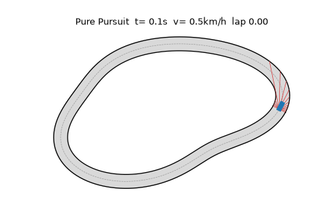
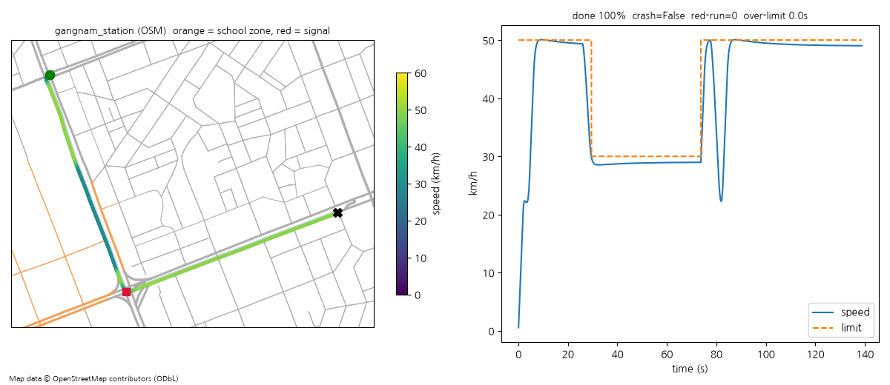
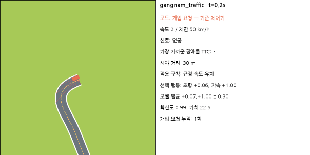

# 자율주행 시작 프로젝트 (`autonomous_driving/`)

위에서 내려다본 2D 도로에서 자동차가 스스로 달리는 **자율주행 연습장**이에요.
numpy·matplotlib 중심이라 **CPU만으로** 돌아가고, GPU·유료 서비스·Hugging Face는 쓰지 않아요.



무엇을 할 수 있나요?

1. **합성 서킷**에서 기준 제어기(Pure Pursuit + PID)로 달리기
2. **실제 한국 도로**(OpenStreetMap, 강남역·대치동 어린이보호구역)에서 한국 교통 규칙을 지키며 달리기 → [`korea_roads/`](korea_roads/README.md)
3. **시골길**(좁은 1차로·비포장·밤·보행자·일반 차량 흐름) 절차 생성 도로 + **실제 OSM 시골길**(경기 양평군 서종면 정배리)
4. **개선 반복**: `improve.py` 한 번이면 학습 → 벤치마크 → 나빠진 곳 없을 때만 최고 모델 교체 → 리더보드 기록 → [`docs/발전전략.md`](docs/발전전략.md)
5. **자율 주행 모드**: `autopilot.py`가 학습 모델로 운전하고, 위험하면 '인간 개입 요청'을 띄우고 기준 제어기/안전 정지로 넘김

## 빠르게 실행

```bash
cd autonomous_driving
python -m venv .venv && source .venv/bin/activate
pip install numpy matplotlib pillow pytest pyyaml networkx      # 기본
pip install torch --index-url https://download.pytorch.org/whl/cpu
pip install gymnasium stable-baselines3                         # 강화학습/자율 모드

python run_baseline.py --laps 3           # 합성 서킷 3바퀴
python render_episode.py                  # media/pure_pursuit_trajectory.png, .gif
python run_korea.py --gif                 # 실제 한국 도로 (OSM 캐시 사용) + 카카오맵/네이버지도 링크
python -m autodrive.bench                 # 벤치마크 점수표 (기준 제어기)
python improve.py --budget-minutes 5      # 개선 사이클 1번 (CPU 약 12~15분, 평가 포함)
python improve.py --budget-minutes 5 --rural   # 시골길 단계까지
python autopilot.py --scenario gangnam --model best      # 자율 주행 모드
python autopilot.py --scenario track --model best
python autopilot.py --scenario rural_night --model best --mp4
python -m pytest tests -q                 # 점검 (약 10초)
```

## 폴더 구조

| 파일 | 설명 |
|---|---|
| `autodrive/track.py` | 트랙/경로(닫힌 서킷·열린 도로), 투영, 곡률 |
| `autodrive/car.py` | 운동학 자전거 모델 + 노면 마찰 한계(미끄러짐) |
| `autodrive/sensors.py` | 라이다 비슷한 광선 센서(벽·장애물) |
| `autodrive/env.py` | gymnasium 환경: 관측·보상·장애물·위반 기록 |
| `autodrive/rules.py`, `rules/kr.yaml` | 한국 교통 규칙(우측 통행, 5030, 어린이보호구역, 신호, 우회전 일시정지, 시골길) |
| `autodrive/osm.py`, `autodrive/roads.py` | OSM 다운로드·캐시, 도로 그래프, 경로 만들기, 규칙 칠하기 |
| `autodrive/rural.py` | 시골길 절차 생성기 |
| `autodrive/controllers.py` | 기준 제어기(Pure Pursuit, 속도 계획, 장애물 피하기, 양보) |
| `autodrive/scenarios.py` | 벤치마크·학습 시나리오(커리큘럼, 도메인 무작위화) |
| `autodrive/bench.py` | 점수표·승격 판단 |
| `autodrive/viz.py` | 자율 주행 재생(GIF/MP4/HTML) |
| `improve.py` | 개선 사이클 (DAgger/BC → PPO → 평가 → 승격 → 리더보드·실패 사례) |
| `autopilot.py`, `rules/autopilot.yaml` | 자율 주행 모드 + 안전 감시기 |
| `train_ppo.py` | (예전) 단순 PPO 학습 예시 |
| `results/` | 점수표·리더보드·실패 사례·자율 주행 로그 (작은 텍스트) |
| `weights/` | 모델 가중치 (**git에 안 올림**) |

## 기준 제어기 결과 (합성 서킷)

- 3바퀴 완주, 이탈 0, 바퀴당 약 21초(평균 41 km/h), 차선 중앙에서 평균 0.24 m(허용 2.1 m).
- 벤치마크 14개(도시 10 + 시골길 4) **모두 완주, 이탈·신호 위반 0** — 아래 리더보드의 `pure_pursuit(기준)` 줄.

## 실제 한국 도로 (`run_korea.py`)



| 시나리오 | 경로 | 완주 | 평균 속도 | 차선 편차(평균/최대) | 과속 | 어린이보호구역 과속 | 신호 위반 | 지도 |
|---|---|---|---|---|---|---|---|---|
| `gangnam_station` | 사평대로 → 강남대로 → 서초대로 → 테헤란로 (1559 m, 신호 1곳, 보호구역 354 m) | 100% | 40.5 km/h | 0.041/0.939 m | 0.0 s | 0.0 s | 0 | [카카오맵](https://map.kakao.com/link/map/%EA%B0%95%EB%82%A8%EC%97%AD%20%EC%9D%BC%EB%8C%80,37.497968,127.027482) · [네이버](https://map.naver.com/p?c=127.027482,37.497968,16,0,0,0,dh) |
| `gangnam_reverse` | 테헤란로 → 강남대로 → 서초대로 → 강남대로 (1584 m, 신호 2곳, 보호구역 310 m) | 100% | 37.4 km/h | 0.049/1.319 m | 0.0 s | 0.0 s | 0 | [카카오맵](https://map.kakao.com/link/map/%EA%B0%95%EB%82%A8%EC%97%AD%20%EC%9D%BC%EB%8C%80%20%EC%97%AD%EB%B0%A9%ED%96%A5,37.498127,127.027946) · [네이버](https://map.naver.com/p?c=127.027946,37.498127,16,0,0,0,dh) |
| `daechi_school_zone` | 남부순환로391길 → 남부순환로 → 선릉로 → 남부순환로 → 남부순환로394길 (1049 m, 신호 0곳, 보호구역 417 m) | 100% | 32.9 km/h | 0.075/0.964 m | 0.0 s | 0.0 s | 0 | [카카오맵](https://map.kakao.com/link/map/%EB%8C%80%EC%B9%98%EB%8F%99%20%EC%84%9C%EC%9A%B8%EB%8C%80%EC%B9%98%EC%B4%88%EB%93%B1%ED%95%99%EA%B5%90%20%EC%A3%BC%EB%B3%80%20%EC%96%B4%EB%A6%B0%EC%9D%B4%EB%B3%B4%ED%98%B8%EA%B5%AC%EC%97%AD,37.490970,127.055807) · [네이버](https://map.naver.com/p?c=127.055807,37.490970,16,0,0,0,dh) |

`gangnam_reverse`는 강남역에서 빨간불 우회전 → 정지선에서 완전히 멈춘 뒤 15 km/h 이하로 우회전(우회전 일시정지)해요.


자세한 규칙과 링크: [`korea_roads/README.md`](korea_roads/README.md). 지도 데이터 © OpenStreetMap contributors (ODbL).

## 시골길 (`autodrive/rural.py`)

도시와 따로 학습·평가하는 단계예요.

- **좁은 길**: 폭 4.6~5.4 m 1차로(중앙선 없음) 70%, 중앙선 있는 지방도 30%. 마주 오는 차가 보이면 오른쪽 끝으로 붙고 15 km/h 이하로 엇갈림(양보).
- **비포장·자갈**: 마찰 0.45~0.6, 방향이 조금씩 흔들림(미끄러짐 잡음).
- **굽이·언덕**: 앞이 보이는 거리 = 굽이(√(8·R·m)), 언덕 꼭대기, 밤 전조등 거리 중 가장 짧은 것. 그 거리 안에서 멈출 수 있는 속도(반응 1초 + 4 m/s²)를 넘으면 '시야 과속'.
- **밤**: 밝기 0.05~0.25 → 센서 거리↓·잡음↑, 시야↓.
- **일반 차량 흐름** (농기계는 넣지 않아요): 속도가 제각각인 **앞차**(18~50 km/h, 내 차를 들이받지 않게 차간 유지), 좁은 길에서 **마주 오는 차**(오른쪽 끝으로 붙어 15 km/h 이하로 엇갈림),
  **옆길에서 들어오는 차**(내 차가 30~45 m 앞까지 오면 길가에서 내 차로로 들어와 출발 → 감속·차간 유지), **앞지르기는 허용 구간에서만**
  (중앙선 있는 2차로 + 앞 100 m 직선 + 어린이보호구역·언덕 꼭대기 앞 아님 + 시야 100 m 이상 + 마주 오는 차 없음; 좁은 1차로는 금지). 허용 구간에서 앞지르는 동안의 중앙선(점선) 넘기는 위반이 아니에요.
- **보행자**(길가·길 건너기, 중앙선 있는 길에선 중앙선을 넘지 않고 내 차로 안에서 띄우며 서행), **길가 물건**. 길 밖(농수로·낭떠러지)으로 나가면 사고.
- **비포장·자갈 서행**: 기준 운전자는 자갈 구간에서 22 km/h 이하(`rules/kr.yaml` `gravel_speed_kmh`).
- **제한속도**(`rules/kr.yaml`): 도시 밖 일반도로 60 km/h(도로교통법 시행규칙 제19조, 편도 1차로), 좁은 1차로 40 km/h(표지 기준 근사), 마을 어린이보호구역 30 km/h.
- **관측 추가**: 노면 마찰 추정, 도로 폭, 시야 거리, 밝기, 가장자리 여유, 마주 오는 차 거리 (+ 앞 장애물 거리·접근 속도).
- **보상/지표**: 가장자리 가까움·시야 과속 벌점, **위험한 앞지르기(느린 차를 금지 구간·시야 100 m 미만·마주 오는 차 있을 때 앞지름)**·위험한 엇갈림(마주 오는 차)·보행자 가까이 빠르게 지나기 -10, 안전한 양보 +2.
  새 지표: `legal_overtake`(허용된 앞지르기 수), `entering_conflict`(옆길 진입 차와 충돌).
- **자율 모드 개입 요청 추가**: 좁은 길 마주 오는 차 40 m 안 + 20 km/h 초과, 위험한 앞지르기, 옆길에서 들어오는 차 30 m 안 (`rules/autopilot.yaml`).

### 실제 한국 시골길 (OpenStreetMap, 경기 양평군 서종면 정배리)

예전에는 시골길이 **절차 생성기(`rural.py`)뿐**이었어요(도시 OSM 경로만 만들었고, 시골 지역은 받아 둔 데이터가 없었음). 이제 실제 시골 마을 도로를 받아 벤치마크·학습에 넣었어요.

- 데이터: OSM 공식 API(`/api/0.6/map`, 작은 영역)로 받아 `korea_roads/data/yangpyeong_jeongbae.json`(61 KB)에 캐시. 공용 Overpass 서버가 안 될 때도 받을 수 있어요. © OpenStreetMap contributors, ODbL 1.0.
- 규칙: OSM `maxspeed` 우선, 없으면 중앙선 있는 2차로(secondary·tertiary) 60 km/h, 마을 안길(residential·unclassified·track, lanes=1) 40 km/h, **정배초등학교 300 m 안 30 km/h**(1 m 간격으로 학교까지 거리 계산). `surface`가 비포장이면 자갈 노면. OSM에 고도가 없어 언덕 꼭대기는 넣지 않았어요.

| 시나리오 | 길 | 길이 | 특징 | 지도 확인 |
|---|---|---|---|---|
| `jeongbae_village` | 중미산로(지방도 2차로) | 1627 m | 굽잇길, 정배초 앞 어린이보호구역 556 m, 앞지르기 허용 313 m | [카카오맵](https://map.kakao.com/link/map/정배초등학교,37.602945,127.423257) · [네이버지도](https://map.naver.com/p?c=127.423257,37.602945,16,0,0,0,dh) |
| `jeongbae_night` | 서정로(2차로) | 1519 m | 가로등 없는 밤, 남쪽 굽잇길, 마주 오는 차 2대 | [카카오맵](https://map.kakao.com/link/map/서정로,37.592969,127.425605) · [네이버지도](https://map.naver.com/p?c=127.425605,37.592969,16,0,0,0,dh) |
| `jeongbae_lane` | 마을 안길(1차로, 중앙선 없음) | 718 m | 폭 약 5 m, 40 km/h, 날카로운 굽이 | [카카오맵](https://map.kakao.com/link/map/정배리 마을길,37.607376,127.426487) · [네이버지도](https://map.naver.com/p?c=127.426487,37.607376,16,0,0,0,dh) |

학습 때는 시골길 표본의 35%가 이 실제 길(밤 40%, 차량 흐름 무작위, 중간 출발)이고 나머지는 절차 생성 길이에요.

## 개선 반복 결과 (`improve.py`)

| 모델 | 총점 | 도시 | 시골길 | 완주 | 이탈 | 신호·우회전 위반 | 과속(s) | 어린이보호구역 과속(s) | 시골길 위험 | 승격 |
|---|---|---|---|---|---|---|---|---|---|---|
| pure_pursuit(기준) | 96.97 | 97.86 | 94.77 | 14/14 | 0 | 0 | 0.0 | 0.0 | 0 | - |
| cycle1 | 25.01 | 38.4 | -8.48 | 6/14 | 8 | 2 | 162.8 | 11.2 | 1 | yes |
| cycle2(ppo) | 57.67 | 74.25 | 16.22 | 9/14 | 5 | 2 | 8.3 | 4.0 | 2 | yes |
| cycle3(bc) | 58.7 | 80.29 | 4.72 | 8/14 | 6 | 1 | 6.2 | 3.7 | 1 | no |
| cycle4-rural(bc) | 54.33 | 52.16 | 59.76 | 8/14 | 6 | 1 | 8.3 | 3.8 | 1 | no |
| cycle5-rural(ppo) | 62.93 | 71.73 | 40.92 | 10/14 | 4 | 3 | 5.9 | 5.9 | 1 | no |

- **전(cycle1, 첫 모델) → 후(cycle2, 현재 최고)**: 총점 25.0 → 57.7, 도시 38.4 → 74.3, 완주 6/14 → 9/14, 이탈 8 → 5, 과속 162.8 s → 8.3 s.
- cycle3(도시 80.3)과 시골길 cycle4·5(시골길 16.2 → 59.8 / 40.9)는 점수가 오른 곳이 있었지만 **다른 시나리오가 나빠져서(회귀) 승격 거절** — 승격 규칙이 의도대로 동작했어요. 특히 시골길 학습 때 도시 점수가 74.3 → 52.2 / 71.7로 떨어져서 막혔어요(도시 회귀 금지).
- 몇 분짜리 CPU 학습이라 아직 기준 제어기(총점 97.0)에 못 미쳐요. 다음 단계는 `docs/발전전략.md` 참고.
- cycle2는 승격 판단을 처음에 시골길까지 넣어 했다가(아직 시골길을 배우기 전이라 불공정) 거절됐고, 도시 단계는 도시 벤치마크로만 판단하도록 고친 뒤 같은 후보를 다시 판단해 승격했어요.


### 시골길 수정 뒤 (벤치마크 v2.1: 시골길 일반 차량 흐름 + 실제 OSM 시골길, 도시·시골 섞기 학습)

| 모델 | 총점 | 도시 | 시골길 | 이탈 | 신호·우회전 위반 | 시골길 위험 |
|---|---|---|---|---|---|---|
| 기준 제어기 | 97.96 | 97.86 | 98.09 | 0 | 0 | 0 |
| 이전 최고(사이클 2) | 60.25 | 75.49 | 41.21 | 7 | 2 | 3 |
| **새 최고(사이클 14)** | **83.65** | **83.89** | **83.35** | **2** | 2 | 3 |

```bash
python improve.py --budget-minutes 6 --rural            # 섞기 학습(도시 50 : 시골 50, 도시 anchor) — 기본
python improve.py --budget-minutes 6 --rural --init last # 직전 후보에서 이어 학습 (비교·anchor 는 최고 모델)
python improve.py --rural --promote-cycle 14             # 학습 없이 후보 다시 판단
python tools/diagnose_forgetting.py weights/best.zip ... # 잊어버림 진단
```

원인·수정·관문 규칙: [`docs/시골길_회귀_분석.md`](docs/시골길_회귀_분석.md). v2 리더보드: [`results/leaderboard_v2.md`](results/leaderboard_v2.md).

전체 리더보드(v1): [`results/leaderboard.md`](results/leaderboard.md). 설계와 분석은 [`docs/발전전략.md`](docs/발전전략.md).

## 자율 주행 모드 (`autopilot.py`)



- **추론 루프**: `weights/best.zip`(없으면 기준 제어기)을 불러와 매 스텝(0.05초) 조향·가속 명령을 내려요. `--realtime`이면 실제 시간 속도로 돌아요.
- **모델이 스스로 판단**: 차선 유지, 신호(빨간불 정지·우회전 일시정지), 속도(제한속도·굽이·시야), 장애물(정차 차량 피하기·앞차 따라가기·보행자 서행).
- **모드 켜기 조건** (`rules/autopilot.yaml` → `engage`): 최고 모델 점수표에서 모든 시나리오 완주율 ≥ 95%, 이탈·충돌 0, 신호/우회전/시골길 위험 위반 0, 어린이보호구역 과속 ≤ 1초. 못 넘으면 자동으로 기준 제어기(`--force`로 시험 가능).
- **안전 감시기** (`monitor`): 하나라도 걸리면 **인간 개입 요청**(빨간 배너 + 터미널 벨, `--alert-cmd "notify-send ..."`로 데스크톱 알림) → 기준 제어기로 최소 3초, 괜찮아지면 자율 모드 복귀.
  - 충돌 예상 시간 TTC < 2초 (1초 미만이면 바로 **안전 정지**)
  - 자신 없음: 모델 행동과 기준 제어기 행동 차이 > 0.6, 또는 0.5초 사이 가치 추정 4 이상 하락
  - 처음 보는 상황(OOD): 학습 관측 분포에서 6σ 이상 벗어남
  - 규칙 위반 위험: 제한속도 +5 km/h 초과, 빨간불 앞에서 못 멈출 속도, 가장자리 0.15 m 미만, (시골길) 시야 과속
- **기록·화면**: `results/autopilot_<시나리오>_events.jsonl`(개입 이벤트), `_summary.json`, `media/autopilot_<시나리오>.gif/.mp4`,
  **HTML 재생기** `media/autopilot_<시나리오>.html`(브라우저로 열면 재생·되감기). 오른쪽 패널에 속도/제한, 신호, TTC, 시야, 적용 규칙, 선택 행동, 모델 평균±표준편차, 확신도·가치, 모드, 개입 횟수.

| 실행 | 모드 | 완주 | 자율 비율 | 개입 요청 | 안전 정지 | 위반 |
|---|---|---|---|---|---|---|
| `--scenario gangnam_station --force` | 모델(cycle2) + 안전 감시기 | 100% | 74% | 12 | 0 | {'edge_close_s': 1.0} |
| `--scenario rural_night_gravel --force` | 모델(cycle2) + 안전 감시기 | 100% | 0% | 1 | 0 | {'edge_close_s': 2.5} |

- 기본 실행(`--force` 없이)은 cycle2 점수표가 켜기 조건(완주 95%·이탈 0·위반 0)을 못 넘어서 **자동으로 기준 제어기**로 달려요.
- 강남역: 모델 혼자(벤치마크)는 과속 1.45 s가 있었는데, 감시기가 '자신 없음(기준과 차이)'·'처음 보는 상황' 때 12번 넘겨받아 과속 0·이탈 0으로 완주.
- 시골길 밤: 도시에서만 배운 모델이라 출발하자마자 '처음 보는 상황(OOD)'이 떠서 끝까지 기준 제어기가 운전(자율 0%) — 의도한 안전 동작.


## SUMO + PPO 실제 교통 (`sumo_kr/`)

무료 교통 시뮬레이터 SUMO에서 강남역·대치동 실제 도로망(OSM)과 배경 차량, 신호 속을 한국 규칙(5030·어린이보호구역·신호·우회전 일시정지)으로 달려요. 자세히: [`sumo_kr/README.md`](sumo_kr/README.md)

```bash
pip install eclipse-sumo libsumo traci sumolib pyproj
python -m sumo_kr.train --budget-minutes 8   # 기준 운전자 평가 → BC/DAgger → PPO → 승격
```

| 모델 | 총점 | 도착 | 충돌 | 위반 |
|---|---|---|---|---|
| 기준 운전자 | 99.25 | 6/6 | 0 | 0 |
| 최고 학습 모델 (BC/DAgger) | 95.58 | 6/6 | 0 | 신호 1 |
| BC+PPO (2사이클, 승격 거절) | 74.5 / 72.8 | 5/6 · 6/6 | 1 · 0 | 과속 늘어남 |

**SUMO 자율 주행 모드** (2D와 같은 안전 감시기·같은 `rules/autopilot.yaml`): `python autopilot.py --scenario sumo_gangnam --force`
또는 `python -m sumo_kr.autopilot --eval --force`. 최고 모델이 직접 운전(--force)하면 6판 모두 도착, 자율 비율 86%, 개입 요청 49회
(모델·기준 운전자 차이 28, 처음 보는 상황 20, TTC 1), 충돌·신호 위반·과속 0. 자세히: [`sumo_kr/README.md`](sumo_kr/README.md#자율-주행-모드-인간-개입-요청)

## 위성지도 + 앞 카메라 1대로 사람처럼 운전 (브랜치 `autodrive/vision-sat`, `autodrive/vision/`)

정책이 받는 입력은 **앞 카메라 영상 하나**와 **내비 안내(위성 정렬 지도 위 경로)**, 그리고 계기판 값뿐이에요.
라이다, 다른 차·보행자 목록, 신호 색 같은 정답 정보는 넣지 않아요. 안전 실드도 쓰지 않아요.

| 부품 | 내용 |
|---|---|
| `vision/ground.py` | 브이월드 위성영상 z18(약 0.5 m/px)을 경로 주변 ±90 m 통로만 받아 바닥 텍스처로 써요(공공누리 제1유형). 캐시는 `satellite/cache/ground/`(git 무시), 키는 `VWORLD_API_KEY` 환경변수로만 받아요 |
| `vision/camera.py` | **테슬라식 앞 카메라**: 앞 유리 위쪽 가운데(룸미러 뒤), 차 중심선(좌우 0 m), 높이 1.35 m, 앞 범퍼에서 0.8 m 뒤(뒷바퀴 축 +2.45 m), 3° 아래로 숙임, 수평 화각 55°, 128×72, 10 Hz. 위성 바닥 위에 도로·차선·정지선·횡단보도·어린이보호구역 붉은 포장을 칠하고, 차·보행자·물체는 상자, 신호등은 한국식 가로형 3구(교차로 건너편 22 m, 높이 5 m), OSM 건물은 높이 태그 또는 층수×3.2 m로 그려요. 밤에는 전조등을 켠 것처럼 그려요 |
| `vision/nav.py` | GPS·IMU 잡음(치우침 σ 0.8 m, 방향 1.5°) 위치를 지도에 맞추고, 4~40 m 앞 경로 방향, 굽이, 제한속도·보호구역 안내, 다음 신호 교차로까지 거리(색은 안 줌), 도로 종류를 줘요. 차선 안 좌우 위치는 주지 않아서 카메라로 맞춰야 해요 |
| `vision/policy.py` | 작은 CNN(약 50만 개 매개변수, CPU). 입력은 지금 RGB 영상, 0.2초 전 흑백 영상, 내비 벡터 28개예요 |
| `train_vision.py` | BC(규칙 기반 기준 제어기 흉내, DART 잡음) 다음 DAgger 4라운드예요. 모두 34만 프레임이고, 출발·정지·급감속 순간에 가중을 줘요 |
| `eval_vision.py`, `render_vision_video.py` | 벤치마크 v2.2 비교, 그리고 시연 영상(왼쪽 카메라, 오른쪽 위성 미니맵과 장착 위치, 모든 프레임에 출처 표시)이에요 |

```bash
set -a; . ~/.config/vworld.env; set +a          # 위성 타일을 처음 받을 때만 필요해요 (그다음은 캐시)
python train_vision.py --rounds 1 --episodes 200 --workers 5 --epochs 5          # BC
python train_vision.py --start-round 1 --rounds 3 --episodes 120 --workers 6 --epochs 3   # DAgger
python eval_vision.py --policy weights/vision_policy.pt --out results/vision_benchmark.json
python render_vision_video.py --scenario gangnam_reverse --s0 720 --dur 30 --out vision_gangnam.mp4
```

### 경로 버그 수정 (벤치마크 v2.1 → v2.2)
- **강남역 역방향**: 경유점이 교차로 남서쪽 노드에 붙어서 교차로 안에서 왼쪽으로 270° 고리를 돌았어요. `remove_detours`가 경로 위 가까운 두 노드 사이의 군더더기를 실제 최단 경로(일방통행 지킴)로 바꿔요. 이제 오른쪽으로 −91° 한 번 꺾어요. 우회전 신호가 사라지지 않도록, 경로에서 15 m 안의 신호 노드도 그 교차로 신호로 봐요.
- **정배리**: 중미산로에서 마을길로 들어가는 OSM 선이 북쪽 집 마당(붉은 포장)을 3~8 m 가로질렀어요. 위성사진에서 읽은 길 가운데 점 3개를 넣고 갈림 노드를 약 4 m 옮겼어요(`korea_roads/scenarios.py` `GEOMETRY_FIXES`). 이제 길 가운데에서 1 m 안쪽이에요.

### 결과 (벤치마크 v2.2, 18개, 실드 없음)

| 정책 | 입력 | 총점 | 도시 | 시골 | 완주 | 이탈(충돌) | 신호 위반 | 시골 위험 행동 |
|---|---|---|---|---|---|---|---|---|
| 규칙 기반 기준 제어기 | 정답 상태 전부 | 97.96 | 97.86 | 98.10 | 18/18 | 0 (0) | 0 | 0 |
| rl-daily 최고 (사이클 19) | 라이다 + 특징 17개 | 90.65 | 86.44 | 95.91 | 17/18 | 1 (1) | 1 | 2 |
| **비전 r4 (이번)** | **카메라 1대 + 내비** | **74.84** | **71.29** | **79.28** | **14/18** | **3 (1)** | **1** | **3** |

라운드별 비전 총점은 BC 7.4 → DAgger r1 30.2 → r2 57.5 → r3 70.3 → r4 74.8이에요(v2.1~v2.2, `results/vision_benchmark_r*.json`).

**남은 실패**
- gangnam_station과 gangnam_traffic은 출발 직후(0 m) 급한 왼쪽 굽이에서 너무 일찍 꺾고 속도도 내다가 5초 만에 길을 벗어나요. 학습 데이터에서 이 출발 상태가 드물어요.
- jeongbae_village는 17% 지점에서 멈춘 뒤 다시 출발하지 못해요(충돌은 아니에요).
- jeongbae_night는 97% 지점에서 차와 부딪혀요(밤, 1건).
- rules_track에서 빨간불 위반 1건, 정배리와 시골 마을에서 보행자 옆 과속(시골 위험 행동) 3건이 있어요.

**정직한 한계**
- 카메라는 단순 래스터라이저예요. 렌즈 왜곡과 눈부심이 없고, 차는 상자예요. 신호등 불빛은 최소 2 px로 번지게 그렸어요.
- 시뮬레이터 도로 폭(6.4 m)이 실제 마을길보다 넓어요.
- 학습 시나리오에는 벤치마크와 같은 지도가 섞여 있어요(신호 시드, 출발점, 차 배치는 무작위). rl-daily와 같은 방식이에요.
- 다음에 할 것: 출발 상태와 멈춘 뒤 재출발 장면을 늘리고, 시간 정보(프레임 여러 장)를 더 주고, PPO로 미세 조정하기.

## 다음에 해 볼 것

[`docs/발전전략.md`](docs/발전전략.md)의 계획 참고: 매주 자동 개선 사이클, 병렬화, 카메라 인식, CARLA/Donkey/SUMO, 실제 시골 OSM 지역(경기·충청 마을의 `highway=unclassified/track`), 덕 프로젝트(`duck_skills_korean/`)의 한국어 명령 연결.

## 규칙

- 무료 자원만 사용(CPU, 필요하면 Kaggle 무료 T4 — 직접 돌리진 않았어요).
- 학습 가중치(`weights/`, `*.pt`, `*.zip` 등)와 시크릿은 저장소에 올리지 않아요(`.gitignore`).
- OSM 데이터는 ODbL 출처 표시, 카카오맵/네이버지도는 링크만.

## 매일 강화학습 + 안전 실드 (브랜치 `autodrive/rl-daily`)

```bash
tools/rl_daily.sh 1 --minutes 4.5 --lr 5e-5 --epochs 1 --round-sec 30 --snapshots   # 사이클 1개 ≈ 8분, 끝나면 결과 커밋·푸시
python autopilot.py --scenario gangnam_traffic --shield   # 모델 + 안전 실드로 자율 주행
python -c "from autodrive.bench import evaluate; print(evaluate('weights/best.zip', shield=True)['total'])"
```

- `boost.py`: 병렬 DAgger 부스트. 일꾼 여러 개가 모델이 운전하는 상태를 모으고(일부는 실드를 씌움), 기준 제어기 행동을 정답으로 붙여요. 남은 실패 시나리오(조금씩 바꾼 판)를 집중 연습하고, 데이터는 `weights/dagger_buffer.npz`에 계속 쌓아요. 신호·앞차·보행자·장애물 같은 중요한 상태는 가중치를 더 줘요. 라운드마다 스냅샷 후보를 평가하고, `improve.py`와 같은 엄격한 관문을 통과해야만 승격돼요(이탈·충돌·위반·위험 행동이 최고보다 많으면 승격 안 함).
- `autodrive/shield.py`: 행동 단위 규칙 마스킹이에요. 규칙상 감속이 필요하면(빨간불, 우회전 일시정지, 앞차, 보행자, 제한속도) 가속을 min(모델, 기준 제어기)로 깎아요. 주변에 차·장애물이 있거나 앞지르는 중이면 조향을 기준 제어기 값으로 바꿔요.
  **점수표는 둘로 나눠요**: `results/best_scorecard.json` = 모델 단독, `results/best_scorecard_shielded.json` = 모델+실드 (실드가 바꾼 스텝 비율도 기록).
