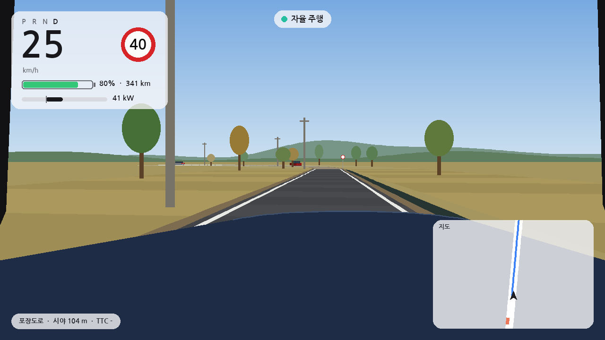
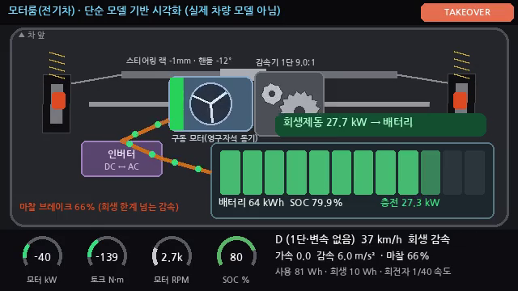
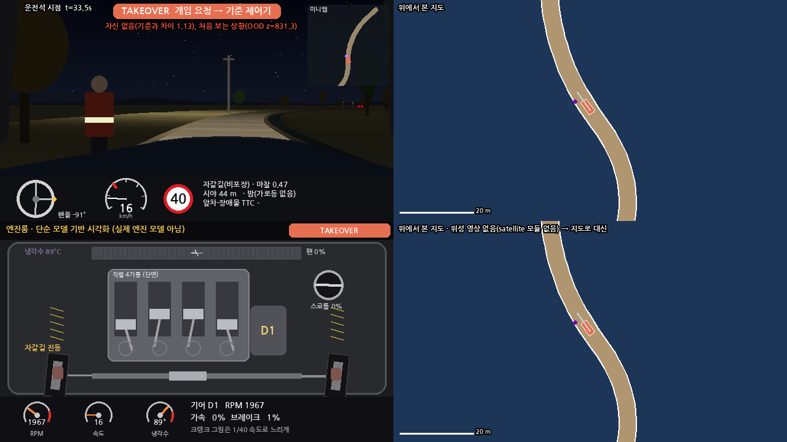

# 자율주행 시작 프로젝트 (`autonomous_driving/`)

위에서 내려다본 2D 도로에서 자동차가 스스로 달리는 **자율주행 연습장**이에요.
numpy·matplotlib 중심이라 **CPU만으로** 돌아가고, GPU·유료 서비스·Hugging Face는 쓰지 않아요.


무엇을 할 수 있나요?

1. **합성 서킷**에서 기준 제어기(Pure Pursuit + PID)로 달리기
2. **실제 한국 도로**(OpenStreetMap, 강남역·대치동 어린이보호구역)에서 한국 교통 규칙을 지키며 달리기 → [`korea_roads/`](korea_roads/README.md)
3. **시골길**(좁은 1차로·비포장·밤·트랙터·보행자·마주 오는 차) 절차 생성 도로
4. **개선 반복**: `improve.py` 한 번이면 학습 → 벤치마크 → 나빠진 곳 없을 때만 최고 모델 교체 → 리더보드 기록 → [`docs/발전전략.md`](docs/발전전략.md)
5. **자율 주행 모드**: `autopilot.py`가 학습 모델로 운전하고, 위험하면 '인간 개입 요청'을 띄우고 기준 제어기/안전 정지로 넘김
6. **전기차 + 운전석 중심 화면**(기본): 큰 운전석 시점 + 미니멀 HUD(속도·제한속도·배터리·전력) + 반투명 미니맵,
   모터룸·위성은 필요할 때만(`--show`), 예전 2×2는 `--layout grid` → [아래](#운전석-중심-화면전기차-모터룸---layout---view)

## 빠르게 실행

```bash
cd autonomous_driving
python -m venv .venv && source .venv/bin/activate
pip install numpy matplotlib pillow pytest pyyaml networkx      # 기본
pip install torch --index-url https://download.pytorch.org/whl/cpu
pip install gymnasium stable-baselines3                         # 강화학습/자율 모드

python run_baseline.py --laps 3           # 합성 서킷 3바퀴
python render_episode.py                  # media/pure_pursuit_trajectory.png, .gif
python run_korea.py --gif                 # 실제 한국 도로 (OSM 캐시 사용) + 카카오맵/네이버지도 링크
python -m autodrive.bench                 # 벤치마크 점수표 (기준 제어기)
python improve.py --budget-minutes 5      # 개선 사이클 1번 (CPU 약 12~15분, 평가 포함)
python improve.py --budget-minutes 5 --rural   # 시골길 단계까지
python autopilot.py --scenario gangnam --model best      # 자율 주행 모드
python autopilot.py --scenario track --model best
python autopilot.py --scenario rural_night --model best --mp4
python -m pytest tests -q                 # 점검 (약 10초)
```

## 폴더 구조

| 파일 | 설명 |
|---|---|
| `autodrive/track.py` | 트랙/경로(닫힌 서킷·열린 도로), 투영, 곡률 |
| `autodrive/car.py` | 운동학 자전거 모델 + 노면 마찰 한계(미끄러짐) |
| `autodrive/sensors.py` | 라이다 비슷한 광선 센서(벽·장애물) |
| `autodrive/env.py` | gymnasium 환경: 관측·보상·장애물·위반 기록 |
| `autodrive/rules.py`, `rules/kr.yaml` | 한국 교통 규칙(우측 통행, 5030, 어린이보호구역, 신호, 우회전 일시정지, 시골길) |
| `autodrive/osm.py`, `autodrive/roads.py` | OSM 다운로드·캐시, 도로 그래프, 경로 만들기, 규칙 칠하기 |
| `autodrive/rural.py` | 시골길 절차 생성기 |
| `autodrive/controllers.py` | 기준 제어기(Pure Pursuit, 속도 계획, 장애물 피하기, 양보) |
| `autodrive/scenarios.py` | 벤치마크·학습 시나리오(커리큘럼, 도메인 무작위화) |
| `autodrive/bench.py` | 점수표·승격 판단 |
| `autodrive/viz.py` | 자율 주행 재생(GIF/MP4/HTML) |
| `autodrive/ev.py` | 전기차 구동계 에너지 계산(즉각 토크·단일 감속기·회생제동+마찰 블렌딩·배터리 SOC) — 움직임·점수에는 영향 없음 |
| `autodrive/views/` | 운전석 중심 화면(`hud.py`, 키 조작 `ui.py`)·운전석 1인칭·지도·전기차 모터룸(단순 모델 시각화)·위성 패널, 보간·MP4/GIF |
| `improve.py` | 개선 사이클 (DAgger/BC → PPO → 평가 → 승격 → 리더보드·실패 사례) |
| `autopilot.py`, `rules/autopilot.yaml` | 자율 주행 모드 + 안전 감시기 |
| `train_ppo.py` | (예전) 단순 PPO 학습 예시 |
| `results/` | 점수표·리더보드·실패 사례·자율 주행 로그 (작은 텍스트) |
| `weights/` | 모델 가중치 (**git에 안 올림**) |

## 기준 제어기 결과 (합성 서킷)

- 3바퀴 완주, 이탈 0, 바퀴당 약 21초(평균 41 km/h), 차선 중앙에서 평균 0.24 m(허용 2.1 m).
- 벤치마크 14개(도시 10 + 시골길 4) **모두 완주, 이탈·신호 위반 0** — 아래 리더보드의 `pure_pursuit(기준)` 줄.

## 실제 한국 도로 (`run_korea.py`)


| 시나리오 | 경로 | 완주 | 평균 속도 | 차선 편차(평균/최대) | 과속 | 어린이보호구역 과속 | 신호 위반 | 지도 |
|---|---|---|---|---|---|---|---|---|
| `gangnam_station` | 사평대로 → 강남대로 → 서초대로 → 테헤란로 (1559 m, 신호 1곳, 보호구역 354 m) | 100% | 40.5 km/h | 0.041/0.939 m | 0.0 s | 0.0 s | 0 | [카카오맵](https://map.kakao.com/link/map/%EA%B0%95%EB%82%A8%EC%97%AD%20%EC%9D%BC%EB%8C%80,37.497968,127.027482) · [네이버](https://map.naver.com/p?c=127.027482,37.497968,16,0,0,0,dh) |
| `gangnam_reverse` | 테헤란로 → 강남대로 → 서초대로 → 강남대로 (1584 m, 신호 2곳, 보호구역 310 m) | 100% | 37.4 km/h | 0.049/1.319 m | 0.0 s | 0.0 s | 0 | [카카오맵](https://map.kakao.com/link/map/%EA%B0%95%EB%82%A8%EC%97%AD%20%EC%9D%BC%EB%8C%80%20%EC%97%AD%EB%B0%A9%ED%96%A5,37.498127,127.027946) · [네이버](https://map.naver.com/p?c=127.027946,37.498127,16,0,0,0,dh) |
| `daechi_school_zone` | 남부순환로391길 → 남부순환로 → 선릉로 → 남부순환로 → 남부순환로394길 (1049 m, 신호 0곳, 보호구역 417 m) | 100% | 32.9 km/h | 0.075/0.964 m | 0.0 s | 0.0 s | 0 | [카카오맵](https://map.kakao.com/link/map/%EB%8C%80%EC%B9%98%EB%8F%99%20%EC%84%9C%EC%9A%B8%EB%8C%80%EC%B9%98%EC%B4%88%EB%93%B1%ED%95%99%EA%B5%90%20%EC%A3%BC%EB%B3%80%20%EC%96%B4%EB%A6%B0%EC%9D%B4%EB%B3%B4%ED%98%B8%EA%B5%AC%EC%97%AD,37.490970,127.055807) · [네이버](https://map.naver.com/p?c=127.055807,37.490970,16,0,0,0,dh) |

`gangnam_reverse`는 강남역에서 빨간불 우회전 → 정지선에서 완전히 멈춘 뒤 15 km/h 이하로 우회전(우회전 일시정지)해요.


자세한 규칙과 링크: [`korea_roads/README.md`](korea_roads/README.md). 지도 데이터 © OpenStreetMap contributors (ODbL).

## 시골길 (`autodrive/rural.py`)

도시와 따로 학습·평가하는 단계예요.

- **좁은 길**: 폭 4.6~5.4 m 1차로(중앙선 없음) 70%, 중앙선 있는 지방도 30%. 마주 오는 차가 보이면 오른쪽 끝으로 붙고 15 km/h 이하로 엇갈림(양보).
- **비포장·자갈**: 마찰 0.45~0.6, 방향이 조금씩 흔들림(미끄러짐 잡음).
- **굽이·언덕**: 앞이 보이는 거리 = 굽이(√(8·R·m)), 언덕 꼭대기, 밤 전조등 거리 중 가장 짧은 것. 그 거리 안에서 멈출 수 있는 속도(반응 1초 + 4 m/s²)를 넘으면 '시야 과속'.
- **밤**: 밝기 0.05~0.25 → 센서 거리↓·잡음↑, 시야↓.
- **트랙터·경운기**(2.5~4.5 m/s), **보행자**(길가·길 건너기), **길가 물건**. 길 밖(농수로·낭떠러지)으로 나가면 사고.
- **제한속도**(`rules/kr.yaml`): 도시 밖 일반도로 60 km/h(도로교통법 시행규칙 제19조, 편도 1차로), 좁은 1차로 40 km/h(표지 기준 근사), 마을 어린이보호구역 30 km/h.
- **관측 추가**: 노면 마찰 추정, 도로 폭, 시야 거리, 밝기, 가장자리 여유, 마주 오는 차 거리 (+ 앞 장애물 거리·접근 속도).
- **보상/지표**: 가장자리 가까움·시야 과속 벌점, 위험한 앞지르기(시야 100 m 미만이거나 마주 오는 차 있을 때)·위험한 엇갈림·보행자 가까이 빠르게 지나기 -10, 안전한 양보 +2.

## 개선 반복 결과 (`improve.py`)

| 모델 | 총점 | 도시 | 시골길 | 완주 | 이탈 | 신호·우회전 위반 | 과속(s) | 어린이보호구역 과속(s) | 시골길 위험 | 승격 |
|---|---|---|---|---|---|---|---|---|---|---|
| pure_pursuit(기준) | 96.97 | 97.86 | 94.77 | 14/14 | 0 | 0 | 0.0 | 0.0 | 0 | - |
| cycle1 | 25.01 | 38.4 | -8.48 | 6/14 | 8 | 2 | 162.8 | 11.2 | 1 | yes |
| cycle2(ppo) | 57.67 | 74.25 | 16.22 | 9/14 | 5 | 2 | 8.3 | 4.0 | 2 | yes |
| cycle3(bc) | 58.7 | 80.29 | 4.72 | 8/14 | 6 | 1 | 6.2 | 3.7 | 1 | no |
| cycle4-rural(bc) | 54.33 | 52.16 | 59.76 | 8/14 | 6 | 1 | 8.3 | 3.8 | 1 | no |
| cycle5-rural(ppo) | 62.93 | 71.73 | 40.92 | 10/14 | 4 | 3 | 5.9 | 5.9 | 1 | no |

- **전(cycle1, 첫 모델) → 후(cycle2, 현재 최고)**: 총점 25.0 → 57.7, 도시 38.4 → 74.3, 완주 6/14 → 9/14, 이탈 8 → 5, 과속 162.8 s → 8.3 s.
- cycle3(도시 80.3)과 시골길 cycle4·5(시골길 16.2 → 59.8 / 40.9)는 점수가 오른 곳이 있었지만 **다른 시나리오가 나빠져서(회귀) 승격 거절** — 승격 규칙이 의도대로 동작했어요. 특히 시골길 학습 때 도시 점수가 74.3 → 52.2 / 71.7로 떨어져서 막혔어요(도시 회귀 금지).
- 몇 분짜리 CPU 학습이라 아직 기준 제어기(총점 97.0)에 못 미쳐요. 다음 단계는 `docs/발전전략.md` 참고.
- cycle2는 승격 판단을 처음에 시골길까지 넣어 했다가(아직 시골길을 배우기 전이라 불공정) 거절됐고, 도시 단계는 도시 벤치마크로만 판단하도록 고친 뒤 같은 후보를 다시 판단해 승격했어요.


전체 리더보드: [`results/leaderboard.md`](results/leaderboard.md). 설계와 분석은 [`docs/발전전략.md`](docs/발전전략.md).

## 자율 주행 모드 (`autopilot.py`)


- **추론 루프**: `weights/best.zip`(없으면 기준 제어기)을 불러와 매 스텝(0.05초) 조향·가속 명령을 내려요. `--realtime`이면 실제 시간 속도로 돌아요.
- **모델이 스스로 판단**: 차선 유지, 신호(빨간불 정지·우회전 일시정지), 속도(제한속도·굽이·시야), 장애물(정차 차량 피하기·앞차 따라가기·보행자 서행).
- **모드 켜기 조건** (`rules/autopilot.yaml` → `engage`): 최고 모델 점수표에서 모든 시나리오 완주율 ≥ 95%, 이탈·충돌 0, 신호/우회전/시골길 위험 위반 0, 어린이보호구역 과속 ≤ 1초. 못 넘으면 자동으로 기준 제어기(`--force`로 시험 가능).
- **안전 감시기** (`monitor`): 하나라도 걸리면 **인간 개입 요청**(빨간 배너 + 터미널 벨, `--alert-cmd "notify-send ..."`로 데스크톱 알림) → 기준 제어기로 최소 3초, 괜찮아지면 자율 모드 복귀.
  - 충돌 예상 시간 TTC < 2초 (1초 미만이면 바로 **안전 정지**)
  - 자신 없음: 모델 행동과 기준 제어기 행동 차이 > 0.6, 또는 0.5초 사이 가치 추정 4 이상 하락
  - 처음 보는 상황(OOD): 학습 관측 분포에서 6σ 이상 벗어남
  - 규칙 위반 위험: 제한속도 +5 km/h 초과, 빨간불 앞에서 못 멈출 속도, 가장자리 0.15 m 미만, (시골길) 시야 과속
- **기록·화면**: `results/autopilot_<시나리오>_events.jsonl`(개입 이벤트), `_summary.json`, `media/autopilot_<시나리오>.gif/.mp4`,
  **HTML 재생기** `media/autopilot_<시나리오>.html`(브라우저로 열면 재생·되감기). 오른쪽 패널에 속도/제한, 신호, TTC, 시야, 적용 규칙, 선택 행동, 모델 평균±표준편차, 확신도·가치, 모드, 개입 횟수.

| 실행 | 모드 | 완주 | 자율 비율 | 개입 요청 | 안전 정지 | 위반 |
|---|---|---|---|---|---|---|
| `--scenario gangnam_station --force` | 모델(cycle2) + 안전 감시기 | 100% | 74% | 12 | 0 | {'edge_close_s': 1.0} |
| `--scenario rural_night_gravel --force` | 모델(cycle2) + 안전 감시기 | 100% | 0% | 1 | 0 | {'edge_close_s': 2.5} |

- 기본 실행(`--force` 없이)은 cycle2 점수표가 켜기 조건(완주 95%·이탈 0·위반 0)을 못 넘어서 **자동으로 기준 제어기**로 달려요.
- 강남역: 모델 혼자(벤치마크)는 과속 1.45 s가 있었는데, 감시기가 '자신 없음(기준과 차이)'·'처음 보는 상황' 때 12번 넘겨받아 과속 0·이탈 0으로 완주.
- 시골길 밤: 도시에서만 배운 모델이라 출발하자마자 '처음 보는 상황(OOD)'이 떠서 끝까지 기준 제어기가 운전(자율 0%) — 의도한 안전 동작.


## 운전석 중심 화면·전기차 모터룸 (`--layout`, `--view`)



시뮬레이터 차는 이제 **전기차**예요. 기본 화면은 **운전석 중심 미니멀 화면**이에요(평평한 색·둥근 모서리·적은 정보):
큰 운전석 시점 위에 큰 디지털 속도, P R N D, 제한속도 표지, 배터리 SOC 막대·주행 가능 거리, 전력 막대(회생은 초록 음수 kW),
오른쪽 아래 반투명 미니맵(진행 방향 위쪽, 갈 길 파란 선). 자율 주행은 작은 점 표시, **개입 요청·안전 정지는 빨간 띠**로 확실히 보여요.
모터룸·위성은 기본으로 숨기고 필요할 때만 오른쪽에 작은 카드로 밀려 들어와요. numpy + Pillow만 써서 CPU로 돌아가고(GPU·3D 엔진 없음),
시뮬레이션(20 Hz)을 보간해서 **25 fps MP4 + GIF**로 저장해요.

```bash
python autopilot.py --scenario rural --rural-cars --force                  # 기본: 운전석 중심 화면 (1280×720)
python autopilot.py --scenario rural --rural-cars --show motor,satellite   # 모터룸·위성 작은 카드도
python autopilot.py --scenario rural --main top                            # 큰 화면 바꾸기: driver|top|motor|satellite
python autopilot.py --scenario rural --layout grid --rural-cars --force    # 예전 2×2: 운전석·지도·모터룸·위성 (= --view all)
python autopilot.py --scenario rural --interactive                         # 창 띄워 실시간(아래 키)
python autopilot.py --scenario rural_night --view driver --rural-cars      # 운전석 한 장(옛 계기판 포함)
python autopilot.py --scenario rural --view both --rural-cars              # 운전석 + 위에서 본 지도 나란히
python autopilot.py --scenario gangnam_traffic --view both --clip-start 68 # 강남역 신호 교차로 구간
python autopilot.py --scenario gangnam --view top                          # 예전 지도+판단 근거 GIF/HTML 재생기
python render_episode.py --view driver                                     # 합성 서킷
```

- `--view main|top|driver|motor|engine|satellite|both|all` (기본 `main`; `engine`은 `motor`의 옛 이름), `--layout main|grid`(기본 `main`),
  `--main driver|top|motor|satellite`, `--show motor,satellite`(기본 숨김, 영상 처음 0.8초 동안 밀려 들어옴).
- `--interactive` 키(matplotlib 창): `m`/`Tab` 큰 화면 바꾸기, `1` 모터룸 카드, `2` 위성 카드(밀려 들어옴/나감), `g` 운전석 중심 ↔ 2×2, `space` 멈춤, `q` 끝.
- 출력: `media/autopilot_<시나리오>_<view>.mp4` / `.gif`(기본 view는 `main`, 8 MB 넘으면 자동으로 줄임), `--still-at 초`면 `_still.png`도.
- `--clip-seconds 18`(0이면 전체), `--clip-start`(없으면 차·보행자·자갈길·개입 요청·신호가 많은 구간 자동 선택), `--fps 25`.
- `--rural-cars`: 시골길의 트랙터·경운기를 **일반 차**로 바꾸고 마주 오는 차를 더해요(농기계는 시골길 시나리오에서 빼는 중).
  화면에서도 트랙터는 일반 차로 그려요.

**전기차 구동계** (`autodrive/ev.py`) — 에너지 계산용 단순 모델. 차의 움직임(가속도 명령 → 속도)은 그대로라
**주행 결과·점수표·한국 규칙·PPO는 바뀌지 않아요**(기준 제어기 96.97 / 최고 모델 57.67, 바꾸기 전후 시나리오별 점수 똑같음).
- 즉각 토크: 단일 감속기 9.0:1(변속·공회전 RPM 없음), 모터 최대 350 N·m·150 kW, 바퀴 반지름 0.33 m → 0 km/h부터 바로 최대 가속, 토크 응답 0.03 s.
- 회생제동: 감속에 필요한 힘을 먼저 모터로 받고(최대 60 kW·2.0 m/s², 약 9 km/h 아래에서 줄어듦) 모자라면 마찰 브레이크가 보태요(블렌딩). 회생 효율 70 %.
- 배터리 64 kWh, 처음 SOC 80 %: 모터 출력/90 % + 보조 0.4 kW만큼 줄고 회생만큼 늘어요. 질량 1900 kg, Cd·A 0.62, 구름저항 0.011.

**운전석 시점** (`autodrive/views/driver.py`)
- 카메라: 뒤축 기준 앞 1.3 m, **왼쪽 0.37 m(한국 차 운전석)**, 눈높이 1.25 m, 수평 시야각 90°, 1.5° 아래로.
  우측통행이라 노란 중앙선/차선은 내 왼쪽, 길 가장자리·농수로는 오른쪽에 보여요. 카메라 뒤 도로는 잘라내서(near-plane clipping) 뒤집혀 나오지 않아요.
- 노면: 아스팔트 / 자갈길(비포장) / 어린이보호구역 붉은 포장, 흰 가장자리선, 양방향 도로의 노란 중앙선(좁은 시골 1차로는 없음), 같은 방향 2차로 흰 점선, 정지선.
- 길가: 가을 논밭, 오른쪽 농수로, 나무·전봇대, 도시는 인도·건물. 지평선 산은 방위각에 고정돼서 차가 돌면 흘러가요.
- 낮/밤: 밤에는 하향등 범위(약 60 m, 좌우 ±20°) 밖이 캄캄하고 별이 보여요. 앞차 미등, 마주 오는 차 전조등 번짐.
- 다른 차는 3D 상자(가까운 것이 먼 것을 가림), 보행자(밤 반사띠), 길가 물건, 신호등(한국식 가로형 4구), 제한속도·어린이보호구역 표지.
- 차 안: 보닛·A필러, 계기판(속도계 + 제한속도 빨간 눈금, 제한속도 표지, 핸들 각도 = 조향각×15), 모드 배너(AUTONOMOUS / TAKEOVER 깜빡임 / SAFE STOP / BASELINE)와 위험 이유, 위에서 본 미니맵.

**모터룸(전기차)** (`autodrive/views/motor.py`, 옛 `engine.py`는 별칭) — ⚠ **단순 모델 기반 시각화(실제 차량 모델 아님)**



- 구동 모터(회전자, 1/40 속도로 그림)·RPM·토크·출력 kW(회생은 음수), 인버터(DC↔AC), 1단 감속기 기어, 바닥 배터리 팩(SOC·충전/방전 kW·사용/회생 Wh)
- 고전압 케이블 전력 흐름 점: 주황 = 배터리 → 모터, 초록 = 회생(모터 → 배터리), "회생제동 ○ kW → 배터리" 표시
- 마찰 브레이크 캘리퍼 색 = 회생 한계를 넘는 감속 몫(블렌딩), 스티어링 랙·앞바퀴 각도 = 실제 조향각, 서스펜션 흔들림 = 자갈길·속도·미끄러짐
- 운전석 한 장(`--view driver`) 계기판에도 RPM·기어 대신 전력 kW·배터리 %를 보여요.

**2×2 화면** (`--layout grid` = `--view all`): 운전석 | 위에서 본 지도 / 모터룸 | 위성.
위성 패널은 `autonomous_driving/satellite/` 모듈(다른 브랜치에서 개발 중)이 있으면 불러 쓰고, 없으면 지도를 보여 주며 "위성 영상 없음"이라고 적어요.
모듈 쪽 약속: `render_panel(env, frame, (W, H))` → 이미지, 또는 `background(env, frame, (W, H), meters_per_px)` → 차 중심 배경 이미지(위에 도로·차를 덧그림).



한계: 땅은 평평하게 그려요(언덕 꼭대기 시야 제한은 시야 거리 숫자로만), 그림자·반사 없음, 건물·나무는 장식(시뮬레이터 충돌과 무관),
다른 차는 상자 모양, 위성 패널은 아직 대체 지도.
전기차 수치는 그럴듯한 값이지 특정 차가 아니고, 차 움직임은 예전 가속도 명령 그대로라 모터 출력 한계·회생 감속감은 에너지 계산과 화면에만 들어가요(점수 보존). `--interactive`는 화면이 있는 PC에서 matplotlib 창으로 떠요(상자에서는 영상 저장으로 확인).

## 다음에 해 볼 것

[`docs/발전전략.md`](docs/발전전략.md)의 계획 참고: 매주 자동 개선 사이클, 병렬화, 카메라 인식, CARLA/Donkey/SUMO, 실제 시골 OSM 지역(경기·충청 마을의 `highway=unclassified/track`), 덕 프로젝트(`duck_skills_korean/`)의 한국어 명령 연결.

## 규칙

- 무료 자원만 사용(CPU, 필요하면 Kaggle 무료 T4 — 직접 돌리진 않았어요).
- 학습 가중치(`weights/`, `*.pt`, `*.zip` 등)와 시크릿은 저장소에 올리지 않아요(`.gitignore`).
- OSM 데이터는 ODbL 출처 표시, 카카오맵/네이버지도는 링크만.
